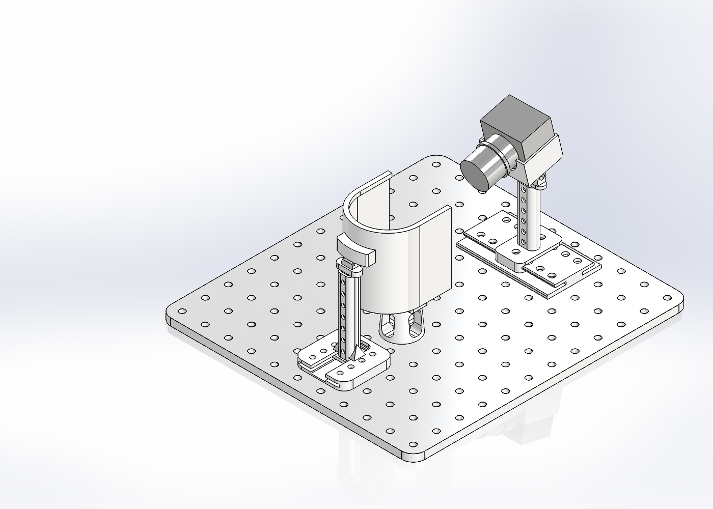

# Hardware Models

## Open The Assembly

Download or extract the complete `hardware/` directory, keeping its folder structure. Open `platform_assembly.SLDASM` in SolidWorks 2024 or a compatible later version. Downloading the assembly file alone is not sufficient. GitHub displays the PNG preview; it does not provide the native SolidWorks editing environment.

The top-level assembly was rebuilt by the maintainer and contains 15 component instances. It replaces the earlier assembly with missing subassembly references. All 27 part files remain available in their existing groups; some circuit-board, infrared-light and support parts are not instantiated in the top-level assembly.

`screen_support/Baseplate.step` is included because the native baseplate part has a linked 3D Interconnect import. Keep this STEP file with `baseplate.SLDPRT`, even when only using the native assembly.

## Validation

The packaged assembly is opened from a separate directory in an independent SolidWorks 2024 session. All 15 components must load without missing-file or ID-mismatch warnings, and their loaded model paths must be inside that directory. The linked STEP source is also checked. Component transforms, referenced configurations, fixed/suppression states and mate definitions are compared with the supplied assembly; a forced rebuild is checked separately.

These are native CAD loading and packaging checks, not physical validation of the apparatus or a claim that every SolidWorks version is compatible. The software and FicTrac runtime are unchanged by this hardware update.

## Language

File and folder names are English. Native feature-tree labels, configuration names and custom-property names retain their existing content and may include localized default names. Switching the application language does not certify or rewrite saved native CAD names. The native CAD metadata has not been certified as English-only.
